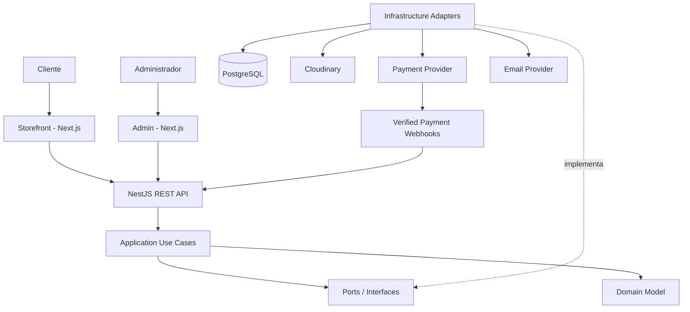

# Arquitectura de software

## Terminología
Se aplica **OOD (Object-Oriented Design / Diseño Orientado a Objetos)**, SOLID y Clean Architecture. También se usan límites de contexto y lenguaje ubicuo inspirados en DDD.

## Vista general

Las flechas sólidas indican "llama a / depende de". La flecha punteada indica "implementa": la infraestructura depende de los puertos, nunca al revés (regla 5).



## Reglas de Clean Architecture
1. `domain` no importa NestJS, Prisma, HTTP, Cloudinary ni SDKs de pasarelas.
2. `application` contiene casos de uso y puertos; depende del dominio.
3. `infrastructure` implementa repositorios, pagos, correo, almacenamiento y persistencia.
4. `presentation` contiene controladores HTTP, DTOs, guards y serialización.
5. Las dependencias apuntan hacia el dominio; nunca al revés.
6. Los controladores no contienen reglas de negocio.
7. Prisma Models no se exponen directamente en la API.
8. Los casos de uso orquestan operaciones; las entidades protegen invariantes.

## Estructura de repositorios

Se usan **dos repositorios**:
- `Telar-Casa-Carrillo-Backend` (este): API NestJS, Prisma, Docker y la documentación de arquitectura.
- `Telar-Casa-Carrillo`: storefront y admin en Next.js. Sus tipos de la API se generan a partir del OpenAPI del backend (`/api/docs-json`, p. ej. con `openapi-typescript`), en lugar de un paquete `contracts` compartido.

Cada módulo de `src/modules/` se divide en capas: `domain/`, `application/`, `infrastructure/` y `presentation/`. ESLint impide que `domain` importe NestJS, Prisma u otras capas, y que `application` importe Prisma, infraestructura o presentación.

```text
Telar-Casa-Carrillo-Backend/
├── src/
│   ├── modules/
│   │   ├── health/                 # salud (Fase 1)
│   │   ├── audit/                  # registro de auditoría (Fase 2)
│   │   ├── identity/               # cuentas, sesiones, roles (Fase 2)
│   │   ├── catalog/                # productos, categorías, artesanos (Fase 3)
│   │   ├── inventory/              # existencias, movimientos, reservas (Fase 4)
│   │   ├── cart/                   # carrito de usuario e invitado (Fase 4)
│   │   ├── shipping/               # direcciones y métodos de envío (Fase 5)
│   │   ├── promotions/             # cupones (Fase 5)
│   │   ├── ordering/               # checkout, pedidos, factura (Fase 5)
│   │   ├── payments/               # Wompi, eventos, conciliación, reembolsos (Fase 6)
│   │   ├── fulfillment/            # despachos y seguimiento (Fase 7)
│   │   ├── notifications/          # correos y alertas (Fase 7)
│   │   ├── reports/                # métricas, CSV, estado del sistema (Fase 7)
│   │   └── privacy/                # Ley 1581: acceso y supresión (Fase 8)
│   ├── shared/
│   │   ├── config/                 # validación de variables de entorno
│   │   ├── domain/                 # errores de dominio
│   │   ├── application/            # puerto UnitOfWork
│   │   ├── infrastructure/         # Prisma, transacciones, logs
│   │   └── presentation/           # filtro de errores problem+json
│   ├── app.module.ts
│   ├── configure-app.ts
│   └── main.ts
├── test/                           # pruebas e2e
├── prisma/
│   ├── schema.prisma
│   └── sql/constraints.sql
├── docs/
└── docker-compose.yml
```

## Diseño orientado a objetos y SOLID
- **SRP:** cada clase tiene una razón principal para cambiar.
- **OCP:** nuevos proveedores de pago se agregan implementando un puerto, no modificando el caso de uso.
- **LSP:** implementaciones de repositorios/proveedores respetan sus contratos.
- **ISP:** interfaces pequeñas y específicas (`PaymentGateway`, `ProductRepository`).
- **DIP:** casos de uso dependen de abstracciones, no de Prisma o SDKs concretos.

## Ejemplo de puertos

```ts
export interface PaymentGateway {
  createCheckout(input: CreateCheckoutInput): Promise<CheckoutSession>;
  verifyWebhook(input: WebhookInput): Promise<VerifiedPaymentEvent>;
  refund(input: RefundInput): Promise<RefundResult>;
}

export interface OrderRepository {
  findById(id: string): Promise<Order | null>;
  save(order: Order): Promise<void>;
}

export interface UnitOfWork {
  execute<T>(work: () => Promise<T>): Promise<T>;
}
```

Los adaptadores `WompiPaymentGateway` y `MercadoPagoGateway` implementan `PaymentGateway`. El caso de uso `InitiateCheckout` no conoce ninguno de esos proveedores.

### Cómo llega la transacción a los repositorios
`UnitOfWork.execute(work)` no recibe ningún cliente de base de datos, así que los repositorios necesitan otra forma de usar la transacción abierta. La implementación con Prisma (`PrismaUnitOfWork`) abre `prisma.$transaction(async (tx) => ...)` y guarda `tx` en un `AsyncLocalStorage`. Cada repositorio Prisma obtiene su cliente de un `PrismaClientProvider` que devuelve el `tx` activo si existe, o el cliente normal si no. Así la interfaz del puerto no expone Prisma (regla 1) y todos los repositorios llamados dentro de `execute` comparten la misma transacción.

Para el checkout, la reserva de inventario y el uso del cupón se hacen con `SELECT ... FOR UPDATE` (o actualizaciones condicionales del tipo `UPDATE ... WHERE "quantityOnHand" - "quantityReserved" >= $n`) dentro de esa transacción.

## Dominios y límites
Los nombres coinciden con las carpetas de `src/modules/`.

- `identity` — Identity & Access: usuarios, roles, permisos, sesiones y tokens.
- `catalog` — Catalog: productos, variantes, categorías, materiales e imágenes, y Artisan (perfil e historia del creador). Los artesanos viven en el mismo módulo porque solo existen para dar contexto a los productos y se administran juntos; el agregado `Artisan` sigue siendo independiente de `Product` (se referencian por id).
- `inventory` — Inventory: existencias, movimientos (con saldo) y reservas. Expone `StockReservations` a otros módulos.
- `cart` — Cart: carrito y líneas (usuario o invitado), revalidado en cada lectura.
- `shipping` — direcciones (código DANE) y métodos de envío.
- `promotions` — Promotions: cupones y sus usos.
- `ordering` — Ordering: checkout (orquesta carrito, inventario, cupones y envío), pedidos, transiciones de estado y factura electrónica (puerto `ElectronicInvoiceIssuer`).
- `payments` — Payments: intentos de pago, eventos de la pasarela, conciliación y reembolsos.
- `fulfillment` — despachos y eventos de seguimiento; mueven el estado del pedido.
- `notifications` — correos al cliente y alertas a la tienda a partir de eventos de dominio.
- `reports` — solo lectura: métricas, exportaciones y estado del sistema.
- `privacy` — derechos del titular de los datos.
- Pendiente: `content` (páginas, banners, testimonios, preguntas frecuentes y newsletter); las tablas existen pero no hay API.

Los módulos se comunican por servicios de aplicación exportados (nunca por repositorios ajenos) y por eventos de dominio (`DOMAIN_EVENTS`), que se entregan después del commit de la transacción.

## Procesos programados
- Ver la tabla de procesos de `operations.md`: reservas vencidas y pedidos vencidos (cada minuto), conciliación de pagos (cada 5 minutos) y carritos de invitado vencidos (cada hora).

Usar `@nestjs/schedule` en una sola instancia o una cola (p. ej. BullMQ) si hay varias réplicas, para no ejecutar dos veces el mismo trabajo.

## Seguridad y operación
- Autorización siempre en backend.
- Contraseñas con Argon2id o bcrypt bien configurado.
- Cookies `HttpOnly`, `Secure`, `SameSite` cuando aplique; rotación/revocación de refresh tokens.
- Validación de DTOs y límites de tamaño.
- Rate limiting, CORS por allowlist, Helmet y logs sin secretos.
- Webhooks con verificación criptográfica, idempotencia y registro de eventos.
- Nunca almacenar PAN/CVV de tarjetas.
- Auditoría de acciones administrativas.
- Secretos solo en gestor de secretos/variables de entorno.
